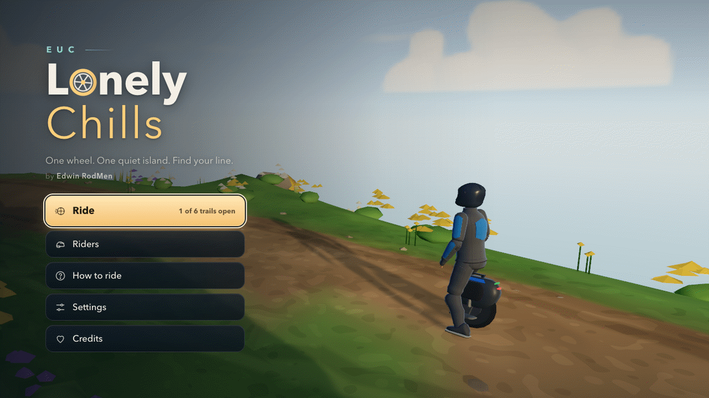
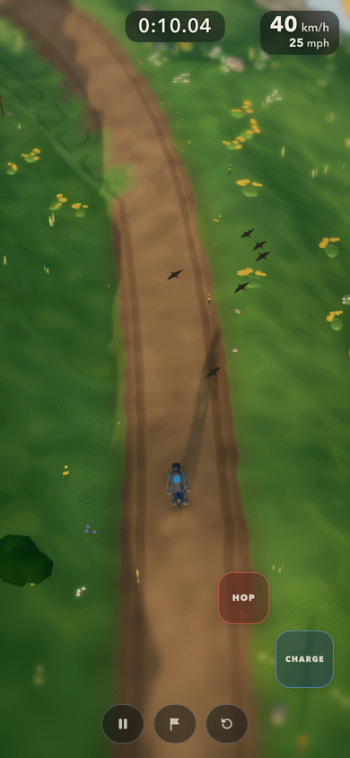
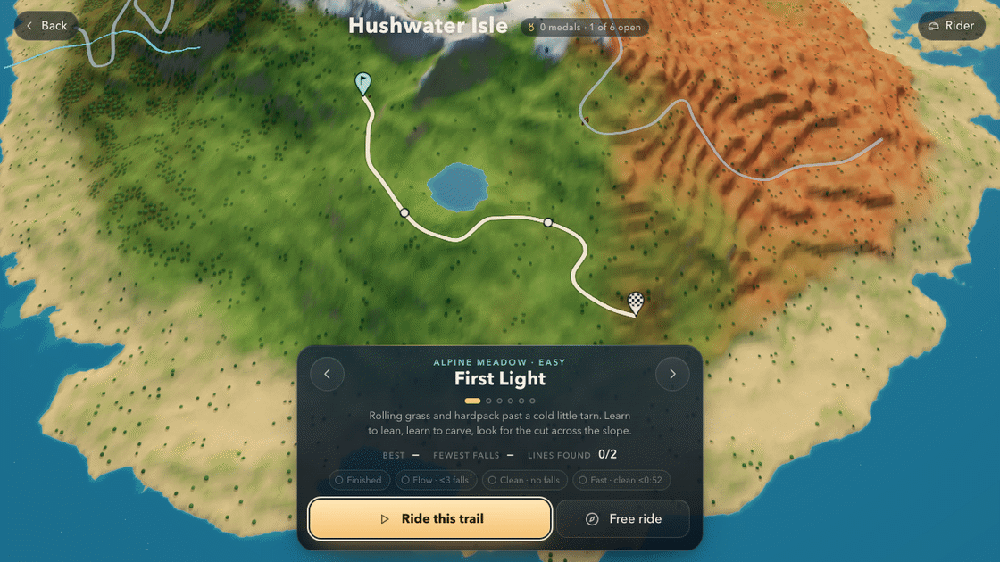
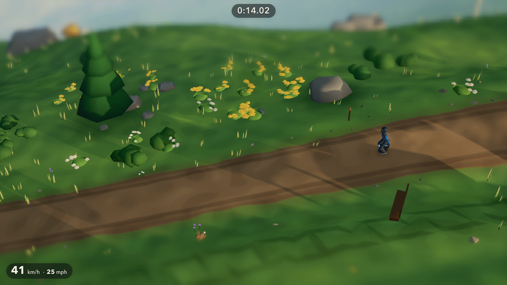
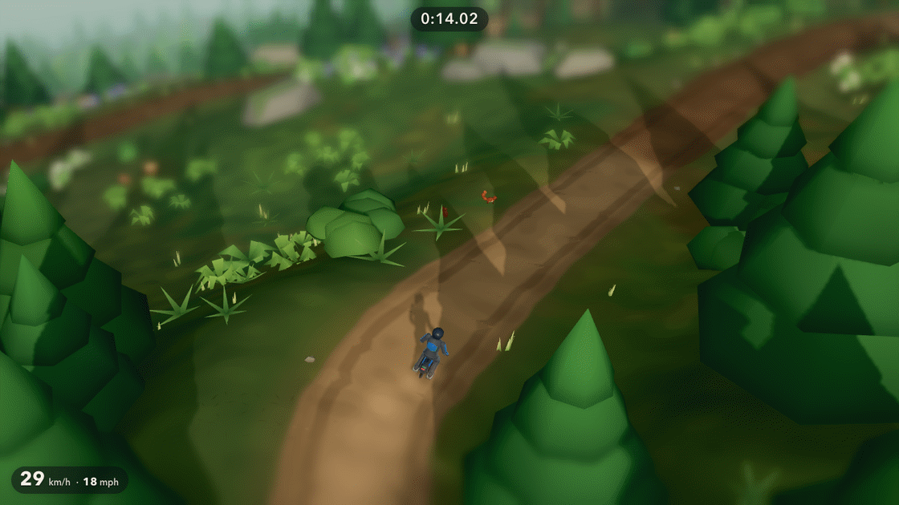
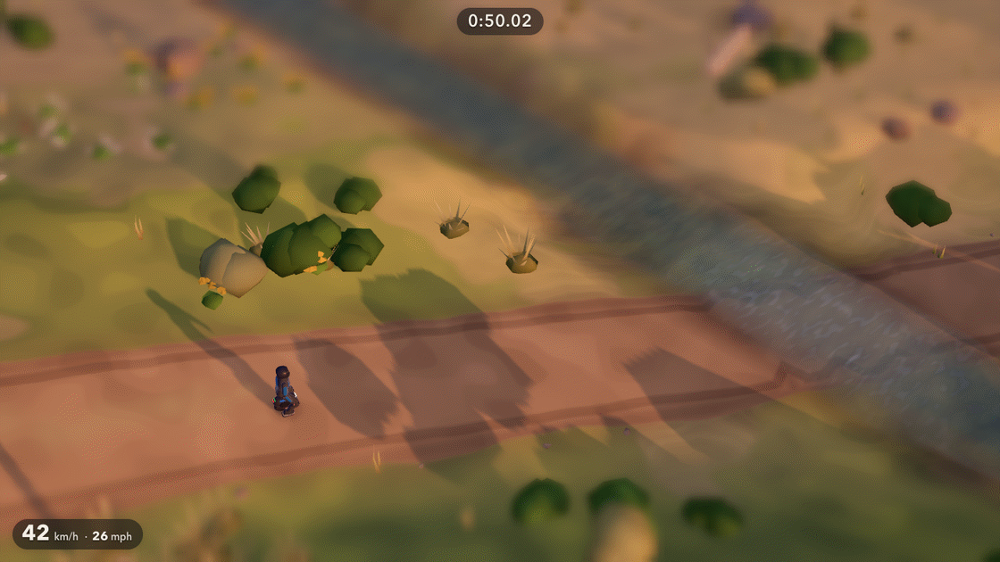
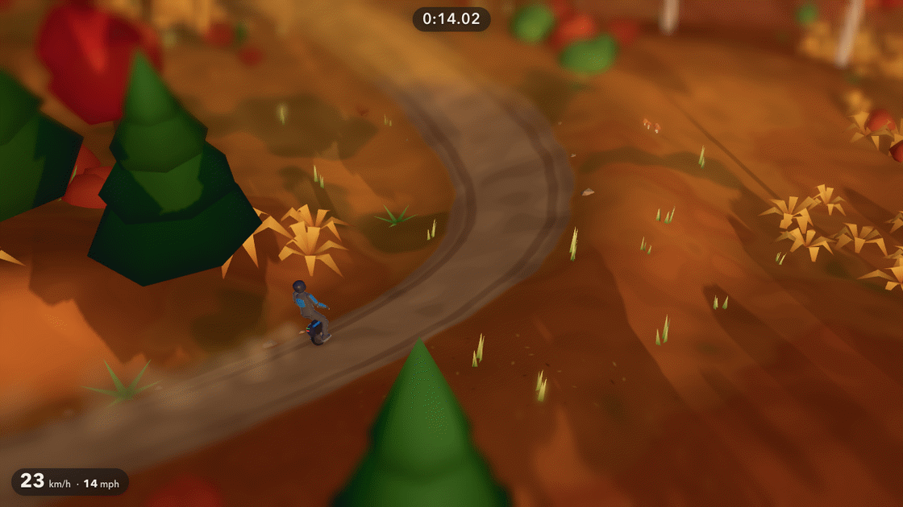
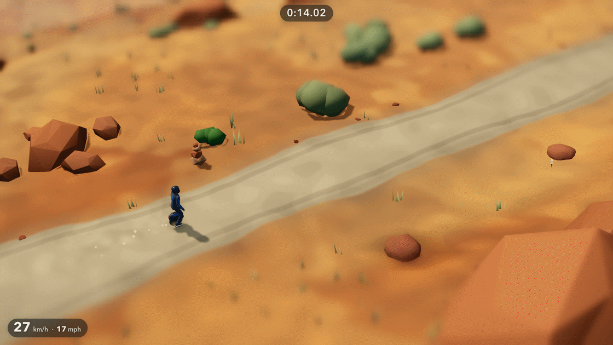
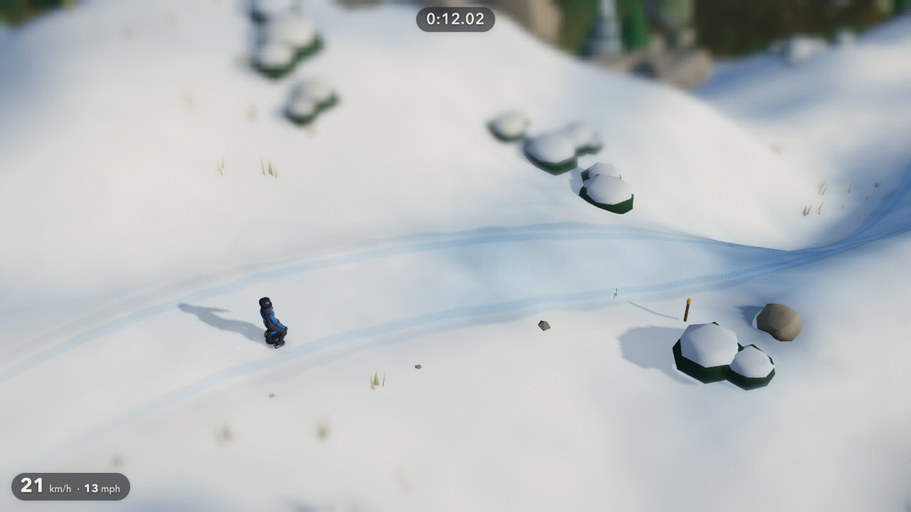

# EUC Lonely Chills

*Ride an electric unicycle down the quiet trails of Hushwater Isle. Point
where you want to go, lean into the carve, find a faster line, crash, laugh,
ride again.* A browser game by **Edwin RodMen**.

### ▶ [Play it in your browser](https://vibezzzcoder.github.io/EUC-Lonely-Chills/)

No download and no account needed: it is made for a current web browser on a
computer, a phone or a tablet.

> **Version 1.0.0.** Six trails on one island, every
> one with checkpoints; three have marked shortcuts and four hide lines to
> find. Four medals to earn on each trail, a ghost of your best run and free
> ride.

## How to ride

**Point where you want to go.** Hold the mouse button or a finger on the spot
where you want the rider to go, or push the stick or the keys that way, as
seen on screen, and the wheel leans, carves and follows. Further from the
rider (or a stick pushed further) is faster. Let go and it rolls to a stop;
point back against the way you are riding to brake hard.

**Read the ground.** Fast corners need room: brake before the turn, not in
it. Loose ground (gravel, leaves, sand, snow and ice) slides, rock grips, and
water slows you down. The wheel lifts off crests and kickers: land straight.
Hop over roots, rocks and small gaps.

**Find your line.** Every trail has a safe main line. On some trails orange
ribbon posts mark a shortcut, and most hide a line that you have to spot in
the terrain yourself. Lines you have found show on the trail map.

**Crash, then ride again.** Falls are part of it. Tap, click or press twice
(or use the checkpoint button) to get straight back on the wheel at the last
checkpoint, or watch the crash play out and it happens by itself. There are no lives and no game over.

**Medals and trails.** Finishing a trail opens the next ones (the trail map
says which trail opens a locked one, and takes you there). Each trail has
four medals: *Finished*, *Flow* (three falls or fewer), *Clean* (no falls)
and *Fast* (a clean run under the trail's target time). A ghost of your best run rides
with you, and **Free ride** takes the clock and the gates away: the whole
island is yours.

## Controls

| Action | Mouse (Point steering) | Keyboard | Controller |
|---|---|---|---|
| Ride (point where you want to go) | Hold the **left button** there (further from the rider is faster) | **W A S D** or the **arrow keys** | Left stick (push further to go faster) or the D-pad; **RT** rides on |
| Brake | Hold **behind** the rider, against the way they ride (let go to roll to a stop) | Point back the other way (let go to roll to a stop) | **LT**, or point the stick back |
| Hop | Click the **right button** (or the wheel, which hops on the press) | **Space** or **J** | **A** (✕ on PlayStation) |
| Charge a bigger hop | Hold the **right button**, let go to hop | Hold **Shift** or **X** | Hold **LB** or **X** (□) |
| Back to the last checkpoint | The **⚑** chip at the bottom | **R** | **Y** (△) |
| Restart the run | Hold the **↻** chip | **T** | **Back** / **View** |
| Pause | The **II** chip | **Esc** or **P** | **Start** / **Menu** |
| Menus | Click | Arrows or **W A S D**, **Enter** or **Space** to choose, **Esc** to go back | D-pad or stick, **A** to choose, **B** to go back |

**On a touch screen**, hold a finger anywhere on the view where you want
the rider to go: further from the rider is faster, and a ring shows where
you are holding. **HOP** and **CHARGE** sit at the bottom right (hold
CHARGE, then tap HOP or slide onto it, for a bigger hop), and the chips at
the bottom centre pause, go back to the last checkpoint and, held,
restart the run. Phones work upright or sideways.

The game is made for *Point* steering and the *Island* view; the other
ways stay in Settings as options. **Settings** let you change the steering (*Point*, the default, or
*Thrills*: up rides, down brakes then reverses, sideways carves, with a
touch stick under the left thumb), the view (*Island*, a high view over the
trail, or *Behind*, close behind the rider), the camera distance, the
quality (*Auto* adapts to your device; or Low, Medium, High: the riding is
the same at every setting), a miniature blur that softens the Island view
above and below the rider (on; not drawn at Low), motion blur (off), the
speed units, the speedometer, a performance readout and the volumes of the
wheel and effects and the nature sounds. Under *Thrills* the mouse works the
menus only.

 

## The trails

Hushwater Isle has six biomes and six trails, each with its own time of day.
You start on First Light; finishing a trail opens the next ones.

### First Light

*Alpine meadow · easy · morning.* Rolling grass and hardpack past a cold
little tarn. Learn to lean, learn to carve, look for the cut across the
slope. Finishing it opens Pinehollow and Saltwind.

### Pinehollow

*Pine forest · medium · overcast.* From the snowline on the shoulder down
dark switchbacks under tall pines. Roots, a creek and a chute the locals
swear is rideable. Opens Ember Run.

### Saltwind

*Maples to the sea · easy · dusk.* Down through the last red maples to the
sea, the lighthouse ahead: a boardwalk over the dunes and a long run of
beach to the finish. Opens Redstone.

### Ember Run

*Autumn woods · medium · golden hour.* Out of the pines into flowing berms
through birch and maple. Leaves hide the grip, and a brook hides the fastest
line. Opens Frostline.

### Redstone

*Red-rock mesas · hard · noon.* Grippy slickrock, soft sand washes and ledges
between the mesas, a grassy saddle halfway. Sand is slow; rock is fast;
ledges are honest. Opens Frostline.

### Frostline

*Summit snow · expert · frost.* From the summit cairn across wind-polished
snow and ice, then down into the first pines. Brake early. Then brake
earlier.

## The riders

Four riders, all available from the start: **Cool Rider**, **Trollina**,
**The Drunkard** and **Officer Dorkins**. They first rode in the author's
earlier game, *EUC Thrills*. Every rider rides the same wheel with
the same handling: a rider is a look and a crash voice, never a stat, so
times are always comparable. Choose one from **Riders** on the title screen
or **Rider** on the trail map.

## Your records

The game saves by itself: the trails you have opened, your best times and
fewest falls, your medals, the lines you have found, the ghost of your best
run on each trail, your rider and your settings. There is no account.

Everything is kept **in this browser, on this device**. Another browser,
another device or a private window starts fresh, and clearing this site's
data in your browser erases the save. On iPhone and iPad, a Home Screen copy
of the game keeps a save of its own, separate from Safari's.

## Put it on your home screen

Added to your home screen, the game opens like an app, without the browser's
address bar.

- **iPhone and iPad (Safari):** open [the game](https://vibezzzcoder.github.io/EUC-Lonely-Chills/), tap **Share**,
  then **Add to Home Screen**.
- **Android (Chrome):** open [the game](https://vibezzzcoder.github.io/EUC-Lonely-Chills/), tap the **⋮** menu,
  then **Add to Home screen** or **Install app**.
- **Computer (Chrome or Edge):** use the browser menu's **Install** option
  for this page.

You still need an internet connection to start the game. Once it is open,
nothing more is downloaded.

## Made in code

There are no image, model or font files in this game. The island, the
trails, the trees and rocks, the riders and their wheels, and the sky are
built by the game's own code as it runs, and the text uses your device's own
fonts. The nature sounds and most of the effects are synthesized while you
play; nine short sound files (the wheel on the ground, the wind, the riders'
crashes and the over-speed alarm) are built into the page, and
[`NOTICE.md`](NOTICE.md) says where each one comes from. The only pictures
here are the icons, drawn by the project's own code, and the screenshots in
`media/`, captured from the game.

## If something is wrong

- **No sound?** Browsers keep sound off until your first key press, click or
  tap. Press a key or tap the screen once, then check the volumes in
  Settings.
- **Choppy?** Try Settings → Quality → Medium or Low, and close other tabs.
  The riding is the same at every setting.
- **Controller not recognised?** Browsers only reveal a controller after one
  of its buttons is pressed while the game is open. Connect it, then press a
  button.
- **Stuck on the loading screen, or a message about the graphics device?**
  The game needs a current browser with WebGPU or WebGL 2. Reload the page,
  or try an up-to-date Chrome or Edge. This version was tested in current
  Chrome, Edge, Firefox and Safari, and in Safari on iPhone and iPad.

## Credits

**EUC Lonely Chills** is a game by **Edwin RodMen**.

- This game: <https://github.com/VibezZzCoder/EUC-Lonely-Chills>
- Website: <https://chills.erodmen.com/>
- Instagram: [@edwin_rodmen](https://www.instagram.com/edwin_rodmen/)
- YouTube: [@EdwinRodMen](https://www.youtube.com/@EdwinRodMen)
- The author's earlier EUC game, *EUC Thrills*: <https://github.com/VibezZzCoder/EUC-thrills>

Sound recordings by gadesound and swiftoid (Freesound, CC0), credited in
[`NOTICE.md`](NOTICE.md). Built with [three.js](https://threejs.org/) (MIT
License).

## License

**Free to play, free to share.** Play it as much as you like, and share the
official game, complete and unchanged, with its credits, `LICENSE` and
`NOTICE.md`, always free of charge.

**Videos are welcome.** Stream it, record it, review it and post screenshots,
monetized or not, without asking first.

**Fan art is welcome too.** Draw it, cosplay it or write about it, and share
it free of charge. Just make it yourself rather than copying the game's
files, and don't present it as official.

**Please don't** sell it or charge for access to it; change it, rename it or
rebrand it; pass it off as someone else's; or copy its code, art, sounds,
riders or trails into other work. (Some of its code, the four riders and four
of its sounds were first published in *EUC Thrills* under the MIT
License and CC BY 4.0, and those terms still apply to that material as
published there: see [`NOTICE.md`](NOTICE.md).)

The full terms are in [`LICENSE`](LICENSE). [`NOTICE.md`](NOTICE.md) covers
authorship, the game's sounds, its fictional places and people, and the
three.js license. For anything else, ask in the
[repository](https://github.com/VibezZzCoder/EUC-Lonely-Chills).

## What's in this repository

| File | |
|---|---|
| `index.html` | The whole game, in one file |
| `manifest.webmanifest`, `icons/` | The name and icons for your home screen |
| `media/` | The screenshots above |
| `LICENSE`, `NOTICE.md` | The terms, authorship and notices |
| `SHA256SUMS.txt` | Checksums: `shasum -a 256 -c SHA256SUMS.txt` should report `OK` for every file |

---

© 2026 Edwin RodMen. All rights reserved. · [Website](https://chills.erodmen.com/) · [@edwin_rodmen](https://www.instagram.com/edwin_rodmen/) · [YouTube](https://www.youtube.com/@EdwinRodMen)
